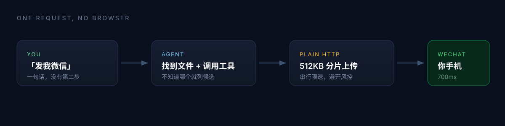

<p align="center">
  
</p>

<p align="center">
  <a href="#测试"></a>
  
  
</p>

---

## 这是什么

一个 DeepSeek Harness 的插件。

装上以后，你在聊天框里说一句「把这个发我微信」，电脑上的文件就到你手机微信里了。

不用开网页版，不用点上传按钮，不用插数据线。第一次要扫个码，之后就不用管了。

## 以前是怎么弄的

想把电脑上的文件弄到手机上，一般是这样：

打开微信，搜文件传输助手，点加号，选文件，等它传，掏手机，点下载。

现在是这样：

> 把刚才那个报表发我微信

然后手机就响了。

<p align="center">
  
</p>

## 装

先确认你已经装好 DSH，并且能找到 profile 目录（一般在 `~/.dsh/profiles/desktop`）。

翻开那个目录下的 `package.json`，两处各加一行：

```jsonc
// dependencies 里
"dsh-wechat-filehelper": "file:C:/Users/你的用户名/my-repos/dsh-wechat-filehelper"

// dsh.profile.bundles 里
"dsh-wechat-filehelper"
```

然后在 profile 目录里跑一次 `pnpm install`，重启 DSH。

重启之后，设置页里会多出一块「微信文件传输助手」。点「扫码登录」，微信扫一下，手机上点确认。就这样。

登录状态存在本地，下次开机不用再扫。

## 用

装好之后最常干的三件事：

**发文件**：跟我说「把这个发我微信」，或者直接给路径。
**发消息**：跟我说「给我微信发句话」。
**收文件**：手机上发给自己的东西，让它下到电脑里。

如果它不知道你说的是哪个文件，会先列一份「最近半小时改过的文件」给你挑，不会反问你「到底是哪个呀」。

## 让 AI 帮你装

不想自己翻配置文件，把下面这段整段复制给任何一个能跑命令的 AI：

```text
帮我在本机装一个 DeepSeek Harness 插件，叫 dsh-wechat-filehelper。

仓库：https://github.com/qinyuan1017/dsh-wechat-filehelper

步骤：
1. 把仓库 clone 到本地任意目录，记住绝对路径
2. 打开 ~/.dsh/profiles/desktop/package.json
   - 在 dependencies 里加：  "dsh-wechat-filehelper": "file:<clone 的绝对路径>"
   - 在 dsh.profile.bundles 数组里加： "dsh-wechat-filehelper"
3. 在 ~/.dsh/profiles/desktop 目录下执行 pnpm install
4. 重启 DSH
5. 检查设置页里有没有出现「微信文件传输助手」这一块，告诉我结果

注意：Windows 上 file: 后面的路径要写成 file:C:/xxx/yyy 这种正斜杠形式。
如果 pnpm install 报 hardlink 或 same file 的错，先把旧的 node_modules/dsh-wechat-filehelper 删掉再装。
```

装完记得自己扫一次码，那一步没法代劳。

## 它不做什么

**只发给自己。** 目标永远是「文件传输助手」，不是群、不是别人。想群发请换工具。

**单文件上限 100MB。** 超了直接报错，不会传一半卡在那儿。

**大文件会慢。** 一片 512KB，每片之间停 1.2 秒。不是写崩了——微信对网页版的调用有频率限制，传太急会被判定「操作过于频繁」，宁可慢点。

**有些微信号登不上。** 微信对部分账号关掉了网页版权限，扫码后会提示不支持。这个跟插件没关系，换号或者用别的办法。

**登录会过期。** 一般能撑一天，失效了它会明确告诉你要重新扫，不会假装还在工作。

## 踩过的四个坑

写这东西的过程基本是「猜一版 → 被服务端打回来 → 扒官方前端源码 → 一遍过」。记下来免得别人再踩。

**二维码是 JPEG，不是 PNG。**
一开始后缀写死 `.png`，图片怎么都打不开。后来才想到按响应的 Content-Type 判断。

**408 不是「过期」，是「这轮没人扫」。**
微信这个接口是 25 秒长轮询，到点没等到人扫码就返回 408。我一开始当成二维码作废，白白让人扫了三次。

**每个请求都得带 `mmweb_appid: wx_webfilehelper`。**
少了这个头，登录接口直接甩一个 `Ret=1100` 参数错误，不告诉你缺哪一项。

**上传的文件字段名是 `filename`，不是 `file`。**
最坑的一个。字段名写错，服务端照样返回成功，只是 `MediaId` 是空的——看着传上去了，其实文件根本没进去。
而且 `uploadmediarequest` 的结构跟网上大多数教程写的也不一样，真正要的是 `ClientMediaId / TotalLen / StartPos / DataLen / MediaType / FromUserName / ToUserName / FileMd5`，分片信息另走 `chunks` 和 `chunk` 两个字段。

## 它是怎么做到的

微信有个「文件传输助手网页版」。这个插件只把那个网页当一次性的登录入口——你扫码，它把凭证存下来，之后所有操作都走普通 HTTP：

扫码 → 换票 → 初始化 → 512KB 分片上传 → 发一条带附件的消息。

没有浏览器，没有无头 Chrome，不模拟点击。快的时候一个文件 700 毫秒。

## 测试

```bash
npm test
```

46 项，全部离线跑，不需要你有微信账号，也不需要联网。

真机也验过：发 171 字节的文件 719 毫秒，1.2MB 的文件分 3 片 3.65 秒，纯文字也通。

## 其他

MIT，随便改。

插件目录的收录 PR 在 [awesome-dsh-plugin#16021](https://github.com/awesome-dsh-plugin/awesome-dsh-plugin/pull/16021)。
